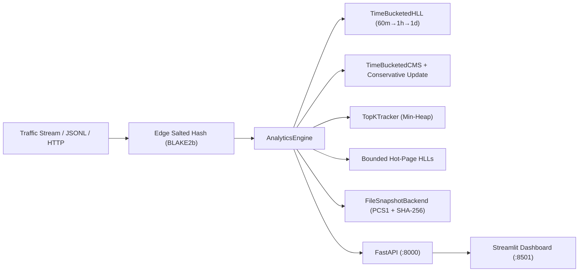

# ProbCount — Probabilistic Counting of Unique Visitors using HyperLogLog and Count-Min Sketch

A production-structured, from-scratch web-analytics engine that counts unique visitors and page-view frequencies in sub-linear memory using **HyperLogLog** and **Count-Min Sketch**, exposed via a **FastAPI** service and an interactive **Streamlit** dashboard.

---

## Architecture



---

## Quick Start

```bash
# 1. Install package with all optional groups (dev, experiments, api, dashboard)
make install

# 2. Run lint, strict typecheck, and test suite
make all

# 3. Launch live 500,000-event demo (FastAPI + Streamlit)
make demo

# 4. Reproduce all Phase 7 benchmarks & verify report numbers
make reproduce
```

---

## Key Features

- **From-Scratch Algorithms (`numpy`-only runtime)**: Pure-Python MurmurHash3 x64-128, `HyperLogLog` (with 6-bit packed serialization & Linear Counting), `SparseHyperLogLog`, `CountMinSketch` (standard, Conservative Update, Kirsch-Mitzenmacher), `TopKTracker`, and `SpaceSaving`.
- **Time-Bucketed Analytics Engine**: Multi-resolution `60m → 1h → 1d` roll-up, retention pruning, watermark late-event tracking, set operations (`hll_union`, `hll_intersection`, `hll_jaccard`), and bounded hot-page memory.
- **FastAPI + Durable Snapshots**: Pydantic v2 schemas, edge BLAKE2b visitor hashing, atomic `PCS1` snapshots with SHA-256 checksums, `X-API-Key` auth, and `7,738.9 events/sec` batch throughput.
- **Streamlit Dashboard**: 8 interactive pages including Overview, Top Pages, Accuracy Lab, Parameter Playground, Sketch Inspector, Merge Demo, Simulator, and Admin.

---

## Results Highlights

| Study | Key Result | Figure |
|---|---|---|
| **HLL Accuracy (`p=14`)** | MAPE `0.491%`–`0.623%` across $n \in [100, 50{,}000]$ (theory SE `0.812%`) | [s1_hll_stats.png](docs/figures/s1_hll_stats.png) |
| **Scalability (5M events)** | HLL stays flat at **12.0 KB** vs **96.22 MB** for `ExactUniqueCounter` | [s5_scalability.png](docs/figures/s5_scalability.png) |
| **Conservative CMS** | Cuts mean over-estimation by **43.6%–52.7%** across Zipf $s \in [0.8, 1.5]$ | [s3_cms_ablation.png](docs/figures/s3_cms_ablation.png) |

---

## Repository Map

```
src/probcount/       Core library (hashing, hll, hll_sparse, cms, topk, windows, engine, storage, api)
dashboard/           Streamlit multipage app & pure-Python data layer
experiments/         Unified Phase 7 benchmark suite (run_all.py, studies.py, stats.py)
tests/               Unit, Hypothesis property, AppTest, and E2E integration tests
scripts/             Demo launcher, async load tester, report number verifier
docs/                Academic report, theory notes, slides, viva Q&A, figures
```

---

## Limitations

- Inclusion-exclusion set intersection (`|A ∩ B|`) exhibits high relative error when overlap is `< 5%` of the union (flagged via `warning=True`).
- Per-page unique visitors are tracked only for the top `hot_pages_limit` pages to keep memory strictly bounded.
- Pure-Python MurmurHash3 is slower than C extensions (`~115k ev/s` batch HLL vs millions in C++).

---

## License & Citation

Released under the [MIT License](LICENSE).

```bibtex
@misc{probcount2026,
  title  = {Probabilistic Counting of Unique Visitors using HyperLogLog and Count-Min Sketch},
  year   = {2026},
  note   = {Capstone Project, v1.0.0}
}
```
