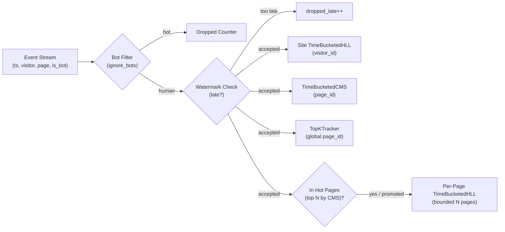

# AnalyticsEngine Architecture & Design Notes

## 1. Data-Flow Diagram

---

## 2. Bounded-Memory Hot-Page Design

Maintaining a separate `HyperLogLog` per page for every distinct URL on a
large site ($P$ pages) would require $O(P \times 2^p)$ memory — which grows
linearly with URL cardinality (e.g., millions of query-string URLs).

Instead, `AnalyticsEngine` tracks per-page `TimeBucketedHLL` instances
**only** for a bounded hot set of at most `hot_pages_limit` pages (ranked by
the global `CountMinSketch` estimate):

- When a new page arrives and the hot set is full, it only evicts the lowest-frequency
  hot page if its own CMS estimate exceeds that page's estimate.
- Memory is strictly bounded by $O(\text{hot\_pages\_limit} \times B \times 2^{p_{\text{page}}})$,
  independent of total distinct URLs.
- Queries for cold/untracked pages return `0.0` (documented sentinel).

---

## 3. Multi-Resolution Roll-Up & Retention

- `TimeBucketedHLL` and `TimeBucketedCMS` store primary buckets (`minute`, `hour`, or `day`).
- Calling `rollup()` merges completed `60`-minute groups into hour buckets and `24`-hour groups
  into day buckets.
- For **HyperLogLog**, `max`-merging is associative, commutative, and idempotent — roll-up is
  **100% lossless**.
- Buckets older than `max_ts - retention_seconds` are automatically pruned.

---

## 4. Limitations

1. **Inclusion-Exclusion Intersection (`setops.py` & `new_visitors`)**:
   Computing $|A \cap B| = |A| + |B| - |A \cup B|$ combines the estimation errors of three
   independent sketches. When $|A \cap B| \ll |A \cup B|$ (below 5%), relative error can be
   large; `SetOpResult.warning` is set to `True` to alert callers.
2. **Conservative Update Merging**: Merging two conservative CMS tables preserves the upper-bound
   guarantee ($\hat{f} \ge f$) but loses the tighter single-stream conservative bound.
3. **Cold Pages**: `unique_visitors_page()` returns `0.0` for pages outside the hot set.
